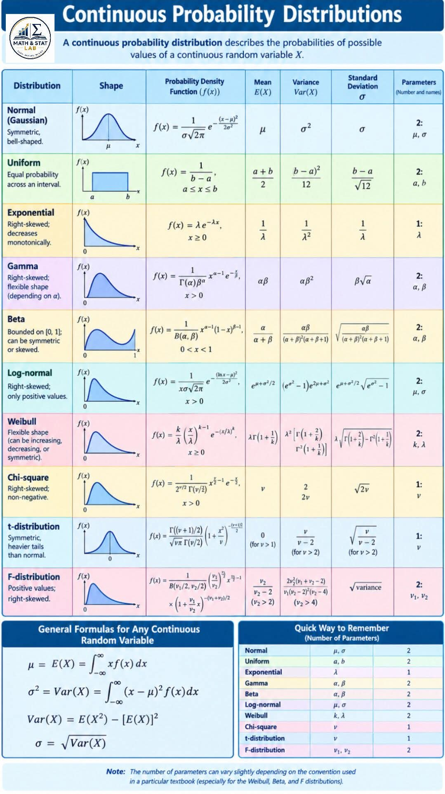

```{=html}
<div style="position:absolute; top:10px; right:10px;">

</div>
```

```{=html}
<style>
body{
  background-color:#E8E6FF;
  font-size:130%;
  text-align:justify;
}
</style>
```

# .Cargar paquetes

```{r}
# Verificar, instalar y activar el paquete "tidyverse"
if (!require(tidyverse)) {
  install.packages("tidyverse")
}
library(tidyverse)

# Verificar, instalar y activar el paquete "kableExtra"
if (!require(kableExtra)) {
  install.packages("kableExtra")
}
library(kableExtra)


# Verificar, instalar y activar el paquete "dplyr"
if (!require(dplyr)) {
  install.packages("dplyr")
}
library(dplyr)
```

# Distribucion Normal

La distribución normal, también conocida como distribución gaussiana o campana de Gauss, es la distribución de probabilidad continua más importante en la estadística.

Su importancia radica en que muchos fenómenos naturales, sociales y económicos siguen este patrón.

La distribución normal es la distribución de probabilidad continua más usada en estadística y una herramienta fundamental para modelar una inmensa variedad de fenómenos en las ciencias, la ingeniería y la economía. Su popularidad se debe a una propiedad matemática conocida como el Teorema del Límite Central, que establece que la suma o el promedio de un gran número de variables aleatorias independientes (sin importar su distribución original) tiende a seguir una distribución normal.

**Características Clave**

La distribución normal es un tipo de distribución de probabilidad continua. Esto significa que la variable aleatoria puede tomar cualquier valor dentro de un rango determinado. Se representa por una curva simétrica en forma de campana, donde la mayor parte de los datos se agrupan alrededor del valor central.

**Forma de Campana:** La distribución es simétrica alrededor de su media, creando una curva con forma de campana. El punto más alto de la campana es la media.

**Media, Mediana y Moda Coincidentes:** En una distribución normal perfecta, estos tres valores son iguales y se encuentran en el centro de la curva.

**Asintótica al Eje Horizontal:** La curva se extiende indefinidamente en ambas direcciones, acercándose al eje x pero sin llegar a tocarlo.

**Regla Empírica:** Alrededor del 68% de los datos se encuentran dentro de una desviación estándar de la media **(μ±σ)**, el 95% dentro de dos desviaciones estándar **(μ±2σ)**, y el 99.7% dentro de tres desviaciones estándar **(μ±3σ)**.

**Parámetros**

La distribución normal está completamente definida por dos parámetros:

**Media *(μ)*:** Indica la ubicación del centro de la curva y el valor más probable.

**Varianza** σ2σ2 o Desviación Estándar (σ): Mide la dispersión o variabilidad de los datos. Una σ grande resulta en una curva más ancha y aplanada, mientras que una σ pequeña crea una curva más estrecha y alta.

**Fórmulas**

La fórmula principal de la distribución normal es la función de densidad de probabilidad (FDP). Esta función no calcula la probabilidad de un punto exacto, sino la densidad de probabilidad en ese punto.

Función de Densidad de Probabilidad (FDP):

$$f(x) = \frac{1}{\sigma\sqrt{2\pi}} e^{-\frac{1}{2}\left(\frac{x-\mu}{\sigma}\right)^2}$$

*x* es el valor de la variable aleatoria.

*μ* es la media.

*σ* es la desviación estándar.

*e* es el número de Euler (aproximadamente 2.71828).

*π* es la constante pi (aproximadamente 3.14159).

Para calcular probabilidades, se utiliza la distribución normal estándar, que tiene una media de 0 y una desviación estándar de 1. Cualquier variable normal puede estandarizarse usando la siguiente fórmula:

Fórmula de Estandarización (puntuación Z):

$$Z = \frac{x - \mu}{\sigma}$$

​La puntuación Z nos dice cuántas desviaciones estándar está un valor dado de la media. Luego, se usan tablas o software estadístico para encontrar las probabilidades correspondientes.

**Ejercicios**

**Ejercicio 6.7**

Un investigador científi co informa que unos ratones vivirán un promedio de 40 meses cuando sus dietas se restringen drásticamente y después se enriquecen con vitaminas y proteínas. Suponiendo que la vidas de tales ratones se distribuyen normalmente con una desviación estándar de 6.3 meses, encuentre la probabilidad de que un ratón dado vivirá:

a\. mas de 32 meses

b\. menos de 38 meses

c\. entre 37 y 49 meses

```{r}
media <- 40 
desviacion_estandar <- 6.3 
```

**Solucion de los incisos**

::: panel-tabset
## Inciso A

cual es la probabilidad de que un raton dado vivira mas de 32 meses

```{r}
prob_mas_de_32 <- 1 - pnorm(32, mean = media, sd = desviacion_estandar)
cat("a)", round(prob_mas_de_32, 4), "\n")
```

La probabilidad de que un raton viva mas de 32 meses es 0.8979

**Grafica**

```{r}
media <- 40
desviacion_estandar <- 6.3
rango <- c(media - 3 * desviacion_estandar, media + 3 * desviacion_estandar)
ggplot(data.frame(x = rango), aes(x = x)) +  # Curva de la distribución normal
  stat_function(fun = dnorm, args = list(mean = media, sd = desviacion_estandar), 
                n = 500, color = "black") +  # Resaltar el área de interés (X > 32)
  geom_area(stat = "function", fun = dnorm, args = list(mean = media, sd = desviacion_estandar),
            fill = "steelblue", xlim = c(32, rango[2]), alpha = 0.5) +  # Etiquetas y títulos
  labs(    title = "Distribucion Normal",    subtitle = "Probabilidad de vivir más de 32 meses",    x = "Vida en meses",    y = "Densidad de Probabilidad"  ) +  theme_bw() +  # Línea para el valor de 32
  geom_vline(xintercept = 32, linetype = "dashed", color = "red") +
  geom_text(aes(x = 32, y = 0.01, label = "32 meses"), hjust = -0.1, vjust = -1)
```

La probabilidad de que un raton viva mas de 32 es 89.79%

## Inciso B

Cual es la probabilidad de que un ratón dado vivirá más de 28 meses.

```{r}
prob_menos_de_28 <- pnorm(28, mean = media, sd = desviacion_estandar)
cat("b)", round(prob_menos_de_28, 4), "\n")
```

La probabilidad de que un ratón viva más de 32 meses es 0.0284.

**Grafica**

```{r}
media <- 40
desviacion_estandar <- 6.3
rango <- c(media - 3 * desviacion_estandar, media + 3 * desviacion_estandar)
ggplot(data.frame(x = rango), aes(x = x)) +  # Curva de la distribución normal
  stat_function(fun = dnorm, args = list(mean = media, sd = desviacion_estandar), 
                n = 500, color = "black") +  # Resaltar el área de interés (X < 28)
  geom_area(stat = "function", fun = dnorm, args = list(mean = media, sd = desviacion_estandar),
            fill = "blue", xlim = c(rango[1], 28), alpha = 0.5) +  # Etiquetas y títulos
  labs(    title = "Distribucion Normal",    subtitle = "Probabilidad de vivir menos de 28 meses",    x = "Vida en meses",    y = "Densidad de Probabilidad"  ) +  theme_bw() +  # Línea para el valor de 28
  geom_vline(xintercept = 28, linetype = "dashed", color = "red") +
  geom_text(aes(x = 28, y = 0.01, label = "28 meses"), hjust = 1.1, vjust = -1)
```

La probabilidad de que un ratón viva más de 32 meses es 2.84%.

## Inciso C

Cual es la probabilidad de que un ratón dado vivirá más de 49 meses.

```{r}
prob_c_superior <- pnorm(49, mean = media, sd = desviacion_estandar)
prob_c_inferior <- pnorm(37, mean = media, sd = desviacion_estandar)
prob_c <- prob_c_superior - prob_c_inferior
cat("c)", round(prob_c, 4), "\n")
```

La probabilidad de que un ratón viva más de 32 meses es 0.6065.

**Grafica**

```{r}
media <- 40
desviacion_estandar <- 6.3
rango <- c(media - 3 * desviacion_estandar, media + 3 * desviacion_estandar)
ggplot(data.frame(x = rango), aes(x = x)) +  # Curva de la distribución normal
  stat_function(fun = dnorm, args = list(mean = media, sd = desviacion_estandar), 
                n = 500, color = "black") +  # Resaltar el área de interés (37 < X < 49)
  geom_area(stat = "function", fun = dnorm, args = list(mean = media, sd = desviacion_estandar),
            fill = "green", xlim = c(37, 49), alpha = 0.5) +  # Etiquetas y títulos
  labs(    title = "Distribucion Normal",    subtitle = "Probabilidad de vivir entre 37 y 49 meses",    x = "Vida en meses",    y = "Densidad de Probabilidad"  ) +  theme_bw() +  # Líneas para los valores de 37 y 49
  geom_vline(xintercept = 37, linetype = "dashed", color = "red") +
  geom_vline(xintercept = 49, linetype = "dashed", color = "red") +
  geom_text(aes(x = 37, y = 0.01, label = "37"), hjust = 1.1, vjust = -1) +
  geom_text(aes(x = 49, y = 0.01, label = "49"), hjust = -0.1, vjust = -1)

```

La probabilidad de que un ratón viva más de 32 meses es 60.65%.

**Ejercicio 6.9**

Una máquina expendedora de bebidas gaseosas se regula para que sirva un promedio de 200 mililitros por vaso. Si la cantidad de bebida se distribuye normalmente con una desviación estándar igual a 15 mililitros,

a.  ¿qué fracción de los vasos contendrá más de 224 mililitros?

b.  ¿cuál es la probabilidad de que un vaso contenga entre 191 y 209 mililitros?

c.  ¿cuántos vasos probablemente se derramarán si se utilizan vasos de 230 mililitros para las siguientes 1000 bebidas?

    ```{r}
    media <- 200
    desviacion_estandar <- 15
    ```
:::

**Solucion de los incisos**

::: panel-tabset
## Inciso A

a.  ¿qué fracción de los vasos contendrá más de 224 mililitros?

```{r}
prob_a <- 1 - pnorm(224, mean = media, sd = desviacion_estandar)
cat("a)", round(prob_a, 4), "\n")
```

La probabilidad de que una fraccion de vasos contendrá más de 224 mililitros es 0.0548

**Grafica**

```{r}
rango <- c(media - 3 * desviacion_estandar, media + 3 * desviacion_estandar)
ggplot(data.frame(x = rango), aes(x = x)) +
  stat_function(fun = dnorm, args = list(mean = media, sd = desviacion_estandar)) +
  geom_area(stat = "function", fun = dnorm, args = list(mean = media, sd = desviacion_estandar),
            fill = "coral", xlim = c(224, max(rango)), alpha = 0.6) +
  labs(    title = "Probabilidad de que un vaso contenga más de 224 ml",    x = "Cantidad de bebida (ml)",    y = "Densidad de probabilidad"  ) +
  geom_vline(xintercept = 224, linetype = "dashed", color = "red") +  theme_minimal()
```

La probabilidad de que una fraccion de vasos contendrá más de 224 mililitros es 54.8%.

## Inciso B

b.  ¿cuál es la probabilidad de que un vaso contenga entre 191 y 209 mililitros?

```{r}
media <- 200
desviacion_estandar <- 15
prob_b_superior <- pnorm(209, mean = media, sd = desviacion_estandar)
prob_b_inferior <- pnorm(191, mean = media, sd = desviacion_estandar)
prob_b <- prob_b_superior - prob_b_inferior
cat("b)", round(prob_b, 4), "\n")
```

La probabilidad de que un vaso contenga entre 191 y 209 mililitros es de 0.4515.

**Grafica**

```{r}
rango <- c(media - 3 * desviacion_estandar, media + 3 * desviacion_estandar)
ggplot(data.frame(x = rango), aes(x = x)) +
  stat_function(fun = dnorm, args = list(mean = media, sd = desviacion_estandar)) +
  geom_area(stat = "function", fun = dnorm, args = list(mean = media, sd = desviacion_estandar),
            fill = "darkgreen", xlim = c(191, 209), alpha = 0.6) +
  labs(    title = "Probabilidad de un vaso entre 191 ml y 209 ml",    x = "Cantidad de bebida (ml)",    y = "Densidad de probabilidad"  ) +
  geom_vline(xintercept = 191, linetype = "dashed", color = "red") +
  geom_vline(xintercept = 209, linetype = "dashed", color = "red") +
  theme_minimal()
```

La probabilidad de que un vaso contenga entre 191 y 209 mililitros es de 45.15%.

## Inciso C

¿cuántos vasos probablemente se derramarán si se utilizan vasos de 230 mililitros para las siguientes 1000 bebidas?

```{r}
media <- 200
desviacion_estandar <- 15
total_vasos <- 1000
prob_derramarse <- 1 - pnorm(230, mean = media, sd = desviacion_estandar)
vasos_derramados <- prob_derramarse * total_vasos
cat("c)", round(vasos_derramados), "vasos\n")
```

Si se utilizan vasos de 230 mililitros para las siguientes 1000 bebidas probablemente se derramarán 23 vasos.

**Grafica**

```{r}
rango <- c(media - 3 * desviacion_estandar, media + 3 * desviacion_estandar)
ggplot(data.frame(x = rango), aes(x = x)) +
  stat_function(fun = dnorm, args = list(mean = media, sd = desviacion_estandar)) +
  geom_area(stat = "function", fun = dnorm, args = list(mean = media, sd = desviacion_estandar),
            fill = "purple", xlim = c(230, max(rango)), alpha = 0.6) +
  labs(    title = "Probabilidad de que un vaso se derrame",    x = "Cantidad de bebida (ml)",    y = "Densidad de probabilidad"  ) +
  geom_vline(xintercept = 230, linetype = "dashed", color = "red") +
  theme_minimal()
```

Si se utilizan vasos de 230 mililitros para las siguientes 1000 bebidas probablemente se derramarán 23 vasos.

**Ejercicio 6.9**

Una máquina expendedora de bebidas gaseosas se regula para que sirva un promedio de 200 mililitros por vaso. Si la cantidad de bebida se distribuye normalmente con una desviación estándar igual a 15 mililitros,

a.  ¿qué fracción de los vasos contendrá más de 224 mililitros?

b.  ¿cuál es la probabilidad de que un vaso contenga entre 191 y 209 mililitros?

c.  ¿cuántos vasos probablemente se derramarán si se utilizan vasos de 230 mililitros para las siguientes 1000 bebidas?
:::

**Ejercicio 6.11**

6.11 Un abogado viaja todos los días de su casa en los suburbios a su ofi cina en el centro de la ciudad. El tiempo promedio para un viaje sólo de ida es 24 minutos, con una desviación estándar de 3.8 minutos. Suponga que la distribución de los tiempos de viaje está distribuida normalmente.

a.  ¿Cuál es la probabilidad de que un viaje tome al menos 1/2 hora?

b.  Si la oficina abre a las 9:00 A.M. y él sale diario de su casa a las 8:45 A.M., ¿qué porcentaje de las veces llegará tarde al trabajo?

c.  Si sale de su casa a las 8:35 A.M. y el café se sirve en la oficina de 8:50 A.M. a 9:00 A.M., cuál es la probabilidad de que se pierda el café?

d.  Encuentre la longitud de tiempo por arriba de la cual encontramos e1 15% de los viajes más lentos.

e.  Encuentre la probabilidad de que 2 de los siguientes 3 viajes tomen al menos 1/2 hora.

    **Parametros**

    ```{r}
    media <- 24
    desviacion <- 3.8
    ```

    ::: panel-tabset
    ## Inciso A

    ¿Cuál es la probabilidad de que un viaje tome al menos 1/2 hora?

    ```{r}
    media <- 24
    desviacion <- 3.8
    prob_a <- 1 - pnorm(30, mean = media, sd = desviacion)
    cat("a)", round(prob_a, 4), "\n")
    ```

    La probabilidad de que un viaje tome al menos 1/2 hora es de 0.0572.

    **Grafica**

    ```{r}
    rango <- c(media - 3 * desviacion, media + 3 * desviacion)
    ggplot(data.frame(x = rango), aes(x = x)) +
      stat_function(fun = dnorm, args = list(mean = media, sd = desviacion), n = 500) +
      geom_area(stat = "function", fun = dnorm, args = list(mean = media, sd = desviacion), fill = "coral", xlim = c(30, max(rango)), alpha = 0.6) +
      labs(title = "Distribucion Normal", x = "Tiempo de viaje (minutos)", y = "Densidad de Probabilidad") +
      geom_vline(xintercept = 30, linetype = "dashed", color = "red") +
      theme_minimal()
    ```

    La probabilidad de que un viaje tome al menos 1/2 hora es de 5.72%.

    ## Inciso B

    Si la oficina abre a las 9:00 A.M. y él sale diario de su casa a las 8:45 A.M., ¿qué porcentaje de las veces llegará tarde al trabajo?

    ```{r}
    prob_b <- 1 - pnorm(15, mean = media, sd = desviacion)
    porcentaje_b <- prob_b * 100
    cat("b)", round(porcentaje_b, 2), "%\n")
    ```

    Si la oficina abre a las 9:00 A.M. y él sale diario de su casa a las 8:45 A.M. 99.11 %xxx llegará tarde al trabajo.

    **Grafica**

    ```{r}
    rango <- c(media - 3 * desviacion, media + 3 * desviacion)
    ggplot(data.frame(x = rango), aes(x = x)) +
      stat_function(fun = dnorm, args = list(mean = media, sd = desviacion), n = 500) +
      geom_area(stat = "function", fun = dnorm, args = list(mean = media, sd = desviacion),fill = "#3de3c2", xlim = c(15, max(rango)), alpha = 0.6) +
      labs(title = "Distribucion Normal", x = "Tiempo de viaje (minutos)", y = "Densidad de Probabilidad") +
      geom_vline(xintercept = 15, linetype = "dashed", color = "red") +  theme_minimal()
    ```

    Si la oficina abre a las 9:00 A.M. y él sale diario de su casa a las 8:45 A.M. 99.11 % llegará tarde al trabajo.

    ## Inciso C

    Si sale de su casa a las 8:35 A.M. y el café se sirve en la oficina de 8:50 A.M. a 9:00 A.M., cuál es la probabilidad de que se pierda el café?

    Este inciso es un problema de distribución binomial, no normal, ya que se trata de un número discreto de “éxitos” (viajes de más de 30 minutos) en un número fijo de intentos (3 viajes). Por lo tanto, la gráfica no es una curva de densidad normal, sino un gráfico de barras de la distribución binomial.

    ```{r}
    prob_c_antes <- pnorm(15, mean = media, sd = desviacion)
    prob_c_despues <- 1 - pnorm(25, mean = media, sd = desviacion)
    prob_c <- prob_c_antes + prob_c_despues
    cat("c)", round(prob_c, 4), "\n")
    ```

    La probabilidad de que se pierda el café es de 0.4051.

    **Grafica**

    ```{r}
    rango <- c(media - 3 * desviacion, media + 3 * desviacion)
    ggplot(data.frame(x = rango), aes(x = x)) +
      stat_function(fun = dnorm, args = list(mean = media, sd = desviacion), n = 500) +
      geom_area(stat = "function", fun = dnorm, args = list(mean = media, sd = desviacion), fill = "gray", xlim = c(min(rango), 15), alpha = 0.6) +
      geom_area(stat = "function", fun = dnorm, args = list(mean = media, sd = desviacion), fill = "gray", xlim = c(25, max(rango)), alpha = 0.6) +
      labs(title = "Distribucion Normal", subtitle = "Probabilidad de perder el café", x = "Tiempo de viaje (minutos)", y = "Densidad de Probabilidad") +
      geom_vline(xintercept = 15, linetype = "dashed", color = "red") +
      geom_vline(xintercept = 25, linetype = "dashed", color = "red") +
      theme_minimal()
    ```

    La probabilidad de que se pierda el café es de 40.51%.

    ## Inciso D

    Encuentre la longitud de tiempo por arriba de la cual encontramos el 15% de los viajes más lentos.

    ```{r}
    valor_d <- qnorm(0.85, mean = media, sd = desviacion)
    cat("d)", round(valor_d, 2), "minutos\n")
    ```

    La longitud de tiempo por arriba de la cual encontramos e1 15% de los viajes más lentos es 27.94 minutos.

    **Grafica**

    ```{r}
    media <- 24
    desviacion <- 3.8
    valor_cuantil <- qnorm(0.85, mean = media, sd = desviacion)
    rango <- c(media - 3 * desviacion, media + 3 * desviacion)
    library(ggplot2)
    ggplot(data.frame(x = rango), aes(x = x)) +
      stat_function(fun = dnorm, args = list(mean = media, sd = desviacion), n = 500) +
      geom_area(stat = "function", fun = dnorm, args = list(mean = media, sd = desviacion), fill = "#11de07", xlim = c(valor_cuantil, max(rango)), alpha = 0.6) +
      labs(    title = "Distribucion Normal", subtitle = "Viajes más lentos (15% superior)",    x = "Tiempo de viaje (minutos)",    y = "Densidad de Probabilidad"  ) +
      geom_vline(xintercept = valor_cuantil, linetype = "dashed", color = "red") +
      geom_text(aes(x = valor_cuantil, y = dnorm(valor_cuantil, mean = media, sd = desviacion), label = paste0(round(valor_cuantil, 2), " min")), vjust = -1, hjust = -0.1) +
      theme_minimal()
    ```

    La longitud de tiempo por arriba de la cual encontramos e1 15% de los viajes más lentos es 27.94 minutos.

    ## Inciso E

    Encuentre la probabilidad de que 2 de los siguientes 3 viajes tomen al menos 1/2 hora.

    ```{r}
    p_exito <- 1 - pnorm(30, mean = media, sd = desviacion)
    n_viajes <- 3
    x_exitos <- 2
    prob_e <- dbinom(x_exitos, size = n_viajes, prob = p_exito)
    cat("e)", round(prob_e, 4), "\n")
    ```

    La probabilidad de que 2 de los siguientes 3 viajes tomen al menos 1/2 hora es 0.0092.

    **Grafico**

    ```{r}
    p_exito <- 1 - pnorm(30, mean = 24, sd = 3.8) 
    n_viajes <- 3 
    exitos_deseados <- 0:n_viajes
    probabilidades <- dbinom(exitos_deseados, size = n_viajes, prob = p_exito)
    df_binomial <- data.frame( num_exitos = factor(exitos_deseados),  prob = probabilidades)
    library(ggplot2)
    ggplot(df_binomial, aes(x = num_exitos, y = prob)) +
      geom_bar(stat = "identity", fill = "skyblue") +
      geom_text(aes(label = round(prob, 4)), vjust = -0.5) +
      labs(    title = "Distribución Binomial de viajes que tardan ≥ 30 minutos",   subtitle = "La probabilidad de tener exactamente 2 'éxitos' es del 0.94%", x = "Número de viajes de al menos 30 minutos",   y = "Probabilidad"  ) +
      theme_minimal()
    ```

    La probabilidad de que 2 de los siguientes 3 viajes tomen al menos 1/2 hora es 0.92%.
    :::

**Ejercicio 6.13**

La vida promedio de cierto tipo de motor pequeño es de 10 años con una desviación estándar de 2 años. El fabricante reemplaza gratis todos los motores que fallen dentro del periodo de garantía. Si él está dispuesto a reemplazar sólo 3% de los motores que fallan, ¿cuánto tiempo de garantía debería ofrecer? Suponga que la duración de un motor sigue una distribución normal.

**Parametros**

```{r}
media <- 10       
desviacion <- 2    
probabilidad_fallo <- 0.03 
```

**Solucion**

```{r}
tiempo_garantia <- qnorm(probabilidad_fallo, mean = media, sd = desviacion)
cat("El fabricante debería ofrecer una garantía de:", round(tiempo_garantia, 2), "años\n")
```

**Grafica**

```{r}
media <- 10
desviacion <- 2
tiempo_garantia <- qnorm(0.03, mean = media, sd = desviacion)
rango <- c(media - 3 * desviacion, media + 3 * desviacion)
ggplot(data.frame(x = rango), aes(x = x)) +
   stat_function(fun = dnorm, args = list(mean = media, sd = desviacion), n = 500, color = "black") +  
  geom_area(stat = "function", fun = dnorm, args = list(mean = media, sd = desviacion),  fill = "purple", xlim = c(min(rango), tiempo_garantia), alpha = 0.6) + 
  labs(    title = "Período de Garantía de los Motores",    subtitle = "El 3% de los motores fallará antes del período de garantía",    x = "Vida útil del motor (años)",    y = "Densidad de Probabilidad"  ) +
  theme_bw() +
  geom_vline(xintercept = tiempo_garantia, linetype = "dashed", color = "red") +
  geom_text(aes(x = tiempo_garantia, y = 0.01, label = paste0(round(tiempo_garantia, 2), " años")), 
            hjust = 1.1, vjust = -1)
```

El fabricante debería ofrecer una garantía de 6.24 años.

**Ejercicio 6.15**

Una compañía paga a sus empleados un salario promedio de \$15.90 por hora con una desviación estándar de \$1.50. Si los salarios se distribuyen aproximadamentede forma normal y se pagan al centavo más 6.15 Una compañía paga a sus empleados un salario promedio de \$15.90 por hora con una desviación estándar de \$1.50. Si los salarios se distribuyen aproximadamente de forma normal y se pagan al centavo más 6.15 Una compañía paga a sus empleados un salario promedio de \$15.90 por hora con una desviación estándar de \$1.50. Si los salarios se distribuyen aproximadamente de forma normal y se pagan al centavo más cercano,

a.  ¿qué porcentaje de los trabajadores reciben salarios entre \$13.75 y \$16.22 inclusive por hora?

b.  ¿el 5% más alto de los salarios por hora de los empleados es mayor a qué cantidad?

    **Parametros**

    ```{r}
    media <- 15.90
    desviacion <- 1.50
    limite_inferior <- 13.75 - 0.005
    limite_superior <- 16.22 + 0.005
    ```

::: panel-tabset
## Inciso A

¿Qué porcentaje de los trabajadores reciben salarios entre \$13.75 y \$16.22 inclusive por hora?

```{r}
prob_a_superior <- pnorm(limite_superior, mean = media, sd = desviacion)
prob_a_inferior <- pnorm(limite_inferior, mean = media, sd = desviacion)
prob_a <- prob_a_superior - prob_a_inferior
porcentaje_a <- prob_a * 100
cat("a)", round(porcentaje_a, 2), "%\n")
```

El porcentaje de trabajadores con salarios entre \$13.75 y \$16.22 es 51.04 %.

**Grafica**

```{r}
rango <- c(media - 3 * desviacion, media + 3 * desviacion)
ggplot(data.frame(x = rango), aes(x = x)) +
  stat_function(fun = dnorm, args = list(mean = media, sd = desviacion), n = 500) +
  geom_area(stat = "function", fun = dnorm, args = list(mean = media, sd = desviacion), fill = "darkgreen", xlim = c(limite_inferior, limite_superior), alpha = 0.6) +
  labs(    title = "Porcentaje de salarios entre $13.75 y $16.22",  x = "Salario por hora ($)", y = "Densidad de probabilidad"  ) +
  geom_vline(xintercept = c(limite_inferior, limite_superior), linetype = "dashed", color = "red") +
  theme_minimal()
```

El porcentaje de trabajadores con salarios entre \$13.75 y \$16.22 es 51.04 %.

## Inciso B

¿El 5% más alto de los salarios por hora de los empleados es mayor a qué cantidad?

```{r}
media <- 15.90
desviacion <- 1.50
valor_b <- qnorm(0.95, mean = media, sd = desviacion)
cat("b)", round(valor_b, 2), "$\n")
```

El 5% más alto de los salarios es mayor a \$18.37.

**Grafica**

```{r}
rango <- c(media - 3 * desviacion, media + 3 * desviacion)
ggplot(data.frame(x = rango), aes(x = x)) +
  stat_function(fun = dnorm, args = list(mean = media, sd = desviacion), n = 500) +
  geom_area(stat = "function", fun = dnorm, args = list(mean = media, sd = desviacion), fill = "purple", xlim = c(valor_b, max(rango)), alpha = 0.6) +
  labs(    title = "El 5% de salarios más altos",  x = "Salario por hora ($)", y = "Densidad de probabilidad" ) +
  geom_vline(xintercept = valor_b, linetype = "dashed", color = "red") +
  theme_minimal()
```
:::

# .Distribucion Ji Cuadrado

La distribución ji-cuadrado $x^2$ es una distribución de probabilidad continua definida solo para valores positivos, que surge de la suma de los cuadrados de variables normales estándar independientes, dependiendo de un parámetro llamado grados de libertad **(𝑘)**. Su media es **𝑘**, su varianza **2𝑘** y su forma varía según **𝑘**: es muy asimétrica para valores pequeños y se aproxima a una normal al crecer. Su función de densidad se expresa mediante la función gamma, y es fundamental en estadística porque se utiliza en pruebas de hipótesis (bondad de ajuste e independencia en tablas de contingencia), en la construcción de intervalos de confianza para varianzas y en la base de otras distribuciones como la t de Student y la F de Fisher. En términos intuitivos, mide la dispersión total al sumar cuadrados de desviaciones de normales, por lo que resulta clave para analizar varianzas y asociaciones

**Parámetros y Características**

A diferencia de la distribución normal, la distribución ji cuadrado no está definida por una media y una desviación estándar, sino por un único parámetro:

**Grados de libertad (*v o df*):** Este parámetro determina la forma de la distribución. A medida que los grados de libertad aumentan, la forma de la distribución se vuelve más simétrica y se aproxima a una distribución normal.

**Valores No Negativos:** La variable ji cuadrado $x^2$ solo puede tomar valores positivos, ya que se calcula a partir de la suma de cuadrados. Por lo tanto, su curva comienza en cero y se extiende hacia la derecha.

**Asimétrica a la Derecha:** La distribución es asimétrica con una cola larga hacia la derecha.

**Media y Varianza:** La media de la distribución es igual a los grados de libertad **(μ=v)**, y la varianza es el doble de los grados de libertad (σ²=2v)

**Dominio**: **𝑋≥0** (nunca toma valores negativos).

**Función de densidad de probabilidad**

$$f(x; k) = \frac{1}{2^{k/2} \Gamma\left(\frac{k}{2}\right)} x^{\frac{k}{2}-1} e^{-x/2}, \quad x > 0$$

**Usos principales en la estadística**

La x2 es fundamental en **estadística inferencial**. Algunos de sus usos:

**Pruebas de hipótesis:**

1.  **Chi-cuadrado de bondad de ajuste:** verificar si los datos observados se ajustan a una distribución teórica.

2.  **Chi-cuadrado de independencia:** evaluar si dos variables categóricas son independientes en una tabla de contingencia.

**Intervalos de confianza:** para la **varianza poblacional** de una normal, ya que está relacionada con la suma de cuadrados de normales.

**Modelos más complejos:** forma parte de la familia de distribuciones asociadas a la **F de Fisher** y la **t de Student**, que también dependen de x2

**Familias de Curvas Chi Cuadrado**

```{r}
k_vals <- c(4, 5, 10)
x <- seq(0, 40, length.out = 1000)
df <- data.frame()
for (k in k_vals) {  df <- rbind(df, data.frame(  x = x,    dens = dchisq(x, df = k),    k = factor(k)  ))}
ggplot(df, aes(x = x, y = dens, color = k)) +
  geom_line(size = 1.2) +
  labs(    title = "Familia de curvas χ²",    subtitle = "Densidades para distintos grados de libertad",    x = "x",
    y = "Densidad",    color = "Grados de libertad (k)"  ) +
  theme_minimal(base_size = 14)
```

**Ejercicios**

**Ejercicio 8.39**

Para una distribución chi cuadrada encuentre

a.  χ0.0252χ0.0252​ cuando v = 15;

b.  χ0.012χ0.012​ cuando v = 7;

c.  χ0.052χ0.052​ cuando v = 24.

    **Solucion a los incisos**

    ```{r}
    a <- qchisq(0.025, df = 15, lower.tail = FALSE)
    b <- qchisq(0.01, df = 7, lower.tail = FALSE)
    c <- qchisq(0.05, df = 24, lower.tail = FALSE)
    a; b; c
    ```

**Gráficas**

```{r}
a <- qchisq(0.025, df = 15, lower.tail = FALSE)
b <- qchisq(0.01, df = 7, lower.tail = FALSE)
c <- qchisq(0.05, df = 24, lower.tail = FALSE)
grafico_chi <- function(df, alpha, critico, titulo){
  x <- seq(0, critico + df*2, 0.1)  # eje x extendido
  dens <- dchisq(x, df)
  data <- data.frame(x = x, y = dens)
  ggplot(data, aes(x, y)) +
    geom_line(color = "blue", size = 1.2) +
    geom_area(data = subset(data, x >= critico), aes(x, y),  fill = "red", alpha = 0.5) +
    geom_vline(xintercept = critico, linetype = "dashed", color = "red", size = 1) +
    labs(title = titulo, subtitle = paste("df =", df, ", α =", alpha, ", crítico =", round(critico,2)), x = "x", y = "Densidad") +    theme_minimal(base_size = 14)}
g1 <- grafico_chi(df = 15, alpha = 0.025, critico = a, titulo = "Distribución Chi-cuadrado (a)")
g2 <- grafico_chi(df = 7, alpha = 0.01, critico = b, titulo = "Distribución Chi-cuadrado (b)")
g3 <- grafico_chi(df = 24, alpha = 0.05, critico = c, titulo = "Distribución Chi-cuadrado (c)")
g1; g2; g3
```

**Ejercicio 8.41**

Para una distribución chi cuadrada encuentre χα2χα2​ tal que

a.  $P(X^2 > \chi^2_{\alpha}) = 0.99$ cuando $v = 4$;

b.  $P(X^2 > \chi^2_{\alpha}) = 0.025$ cuando $v = 19$;

c.  $P(37.652 < X^2 < \chi^2_{\alpha}) = 0.045$ cuando $v = 25$.

    ```{r}
    a <- qchisq(0.99, df = 4, lower.tail = FALSE)
    b <- qchisq(0.025, df = 19, lower.tail = FALSE)
    p_base <- pchisq(37.652, df = 25)
    p_objetivo <- p_base + 0.045
    c <- qchisq(p_objetivo, df = 25)
    a; b; c
    ```

**Grafica**

```{r}
plot_chisq <- function(df, region, alpha = 0.05, case = "a") {
  x <- seq(0, qchisq(0.999, df), length.out = 1000)
  y <- dchisq(x, df)
  data <- data.frame(x = x, y = y)
  if (case == "a" | case == "b") {    shade <- subset(data, x > region)  }
  else if (case == "c") {shade <- subset(data, x > 37.652 & x < region)  }
  ggplot(data, aes(x, y)) +
    geom_line(color = "blue", size = 1) +
    geom_area(data = shade, aes(x, y), fill = "red", alpha = 0.4) +
    labs(  title = paste("Distribución Chi-cuadrado con v =", df), subtitle = paste("Caso", case, "con región sombreada"),      x = "X²", y = "Densidad"    ) +
    theme_minimal()}
chi_a <- qchisq(0.01, df = 4)
plot_chisq(df = 4, region = chi_a, case = "a")
```

```{r}
chi_b <- qchisq(0.975, df = 19)
plot_chisq(df = 19, region = chi_b, case = "b")
```

```{r}
p_left <- pchisq(37.652, df = 25)
target_prob <- p_left + 0.045
chi_c <- qchisq(target_prob, df = 25)
plot_chisq(df = 25, region = chi_c, case = "c")
```

# .Distribucion T de Student

La **distribución *t* de Student** es una distribución de probabilidad continua que surge al estimar la media de una población normalmente distribuida cuando el tamaño de la muestra es pequeño y la varianza poblacional es desconocida. Fue introducida en 1908 por William Sealy Gosset bajo el seudónimo de *Student*.

Matemáticamente, si Z es una variable aleatoria con distribución normal estándar N(0,1) y V es una variable con distribución chi-cuadrado con v grados de libertad, independientes entre sí, entonces la variable

$$T = \frac{Z}{\sqrt{V/v}}$$

sigue una distribución *t* de Student con v grados de libertad.

**Principales características**

-   **Forma**: es simétrica respecto al cero, similar a la normal estándar, pero con colas más pesadas (mayor probabilidad en los extremos).

-   **Parámetro**: depende de los grados de libertad (vv); a mayor vv, la distribución se aproxima a la normal estándar N(0,1).

-   **Media**: 0 (para v\>1v \> 1).

-   **Varianza**: vv−2(para v\>2)v−2v​(para v\>2)

**Usos principales**

-   Pruebas de hipótesis sobre medias (prueba *t* de Student)

-   Construcción de intervalos de confianza para la medias

-   Modelar incertidumbre en muestras pequeñas

**Familia de Curvas para T de Student**

```{r}
set.seed(123)
dfs <- c(3, 5, 10)          # grados de libertad a mostrar
x_range <- seq(-5, 5, by = 0.01)
df_t <- expand_grid(x = x_range, df = dfs) |>
  mutate(dens = dt(x, df))
ggplot(df_t, aes(x = x, y = dens, color = factor(df), group = df)) +
  geom_line(size = 1) +
  labs(    title = "Familia de curvas t-Student",    subtitle = "Diferentes grados de libertad (df)",    x = "x",
    y = "Densidad",    color = "df"  ) +
  theme_minimal(base_size = 12)
```

**Ejercicio 1**

**8.47**\
a) Encuentre $P(T < 2.365)$ cuando $v = 7$.

b)  Encuentre $P(T > 1.318)$ cuando $v = 24$.

c)  Encuentre $P(-1.356 < T < 2.179)$ cuando $v = 12$.

d)  Encuentre $P(T > -2.567)$ cuando $v = 17$.

    **Solucion**

    ```{r}
    a <- pt(2.365, df = 7)
    b <- 1 - pt(1.318, df = 24)
    c <- pt(2.179, df = 12) - pt(-1.356, df = 12)
    d <- 1 - pt(-2.567, df = 17)
    results <- data.frame(
      Inciso = c("a", "b", "c", "d"),
      Resultado = c(a, b, c, d)
    )
    print(results)
    ```

**Graficas**

```{r}
plot_t <- function(df, region = c("left", "right", "between"), 
                   value1, value2 = NULL, title = "") {
  x <- seq(-4, 4, length.out = 1000)
  dens <- dt(x, df)
  data <- data.frame(x = x, y = dens)
  if(region == "left"){
    data$shade <- ifelse(data$x <= value1, data$y, NA)
  } else if(region == "right"){
    data$shade <- ifelse(data$x >= value1, data$y, NA)
  } else if(region == "between"){
    data$shade <- ifelse(data$x >= value1 & data$x <= value2, data$y, NA)
 }
  ggplot(data, aes(x, y)) +
    geom_line(color = "blue", size = 1) +
    geom_area(aes(y = shade), fill = "red", alpha = 0.4) +
    labs(title = title,  subtitle = paste("Distribución t con v =", df), x = "t", y = "Densidad") +
    theme_minimal()
}
plot_t(df = 7, region = "left", value1 = 2.365, 
       title = "a) P(T < 2.365), v = 7")
```

```{r}
plot_t(df = 24, region = "right", value1 = 1.318, 
       title = "b) P(T > 1.318), v = 24")
```

```{r}
plot_t(df = 12, region = "between", value1 = -1.356, value2 = 2.179, 
       title = "c) P(-1.356 < T < 2.179), v = 12")
```

```{r}
plot_t(df = 17, region = "right", value1 = -2.567, 
       title = "d) P(T > -2.567), v = 17")
```

**Ejercicio 8.49**

Dada una muestra aleatoria de tamaño 24 de una distribución normal, encuentre kk tal que:

a.  $P(-2.069 < T < k) = 0.965$

b.  $P(k < T < 2.807) = 0.095$

c.  $P(-k < T < k) = 0.90$

    **Solucion**

    ```{r}
    v <- 24 - 1
    p_left <- pt(-2.069, df = v)   # Probabilidad acumulada en -2.069
    target <- 0.965 + p_left       # Acumulada deseada
    k_a <- qt(target, df = v)
    k_a
    ```

```{r}
p_2807 <- pt(2.807, df = v)
p_k <- p_2807 - 0.095
k_b <- qt(p_k, df = v)
k_b
```

```{r}
k_c <- qt(0.95, df = v)
k_c
```

**Graficos**

```{r}
v <- 23
k_a <- qt(0.965 + pt(-2.069, df=v), df=v)
k_b <- qt(1 - 0.095, df=v, lower.tail = TRUE, ncp = 0)
p_upper <- pt(2.807, df=v)
k_b <- qt(p_upper - 0.095, df=v)
k_c <- qt(0.95, df=v)
k_a; k_b; k_c
```

```{r}
x <- seq(-4, 4, length=500)
dens <- dt(x, df=v)
df_plot <- data.frame(x, dens)
shade_region <- function(a, b, df, title){
  ggplot(df, aes(x, dens)) +
    geom_line(color="blue") +
    geom_area(data=subset(df, x>=a & x<=b),
              aes(x=x, y=dens), fill="skyblue", alpha=0.5) +
    labs(title=title, x="T", y="Densidad") +
    theme_minimal()
}
plot_a <- shade_region(-2.069, k_a, df_plot, "a) P(-2.069 < T < k) = 0.965")
plot_b <- shade_region(k_b, 2.807, df_plot, "b) P(k < T < 2.807) = 0.095")
plot_c <- shade_region(-k_c, k_c, df_plot, "c) P(-k < T < k) = 0.90")
plot_a
```

```{r}
plot_b
```

```{r}
plot_c
```

# .Distribución F de Fisher

La **distribución F**, también conocida como **F de Fisher-Snedecor**, es una distribución de probabilidad **continua** que surge a partir de la razón entre dos variables aleatorias chi-cuadrado normalizadas por sus grados de libertad.

**Definición formal**

Si:

-   $X \sim \chi^2_{v_1}$ (una chi-cuadrado con $v_1$ grados de libertad),
-   $Y \sim \chi^2_{v_2}$ (otra chi-cuadrado con $v_2$ grados de libertad), y $X$ y $Y$ son independientes,

entonces la variable:

$$F = \frac{(X / v_1)}{(Y / v_2)}$$​

sigue una **distribución F** con $(v_1, v_2)$ grados de libertad.

**Propiedades principales**

1.  **Soporte**: F\>0F\>0, es decir, solo toma valores positivos.

2.  **Asimétrica**: la curva de densidad es sesgada a la derecha, especialmente para pocos grados de libertad.

3.  **Esperanza matemática**:

    $$E(F) = \frac{v_2}{v_2 - 2}, \quad \text{para } v_2 > 2$$

4.  **Varianza**:

    $$\operatorname{Var}(F) = \frac{2v_2^2(v_1 + v_2 - 2)}{v_1(v_2 - 2)^2(v_2 - 4)}, \quad \text{para } v_2 > 4$$

5.  Cuando los grados de libertad son grandes, la distribución F tiende a concentrarse cerca de 1.

**Usos más comunes**

1.  **Análisis de Varianza (ANOVA):** se utiliza para contrastar si varias medias poblacionales son iguales.

2.  **Pruebas de hipótesis sobre varianzas:** por ejemplo, para comparar si dos poblaciones tienen varianzas iguales.

3.  **Regresión lineal:** la prueba F sirve para evaluar la significancia global del modelo.

**Familia de Curvas F de Fisher**

```{r}
x <- seq(0, 5, length.out = 500)
df_combinations <- list(
  c(1, 5),
  c(2, 10),
  c(5, 10),
  c(10, 20)
)
df <- data.frame()
for (df_pair in df_combinations) {
  v1 <- df_pair[1]
  v2 <- df_pair[2]
  dens <- df(x, df1 = v1, df2 = v2) # función de densidad de la distribución F
  df <- rbind(df, data.frame(x = x, y = dens,
                             label = paste0("v1=", v1, ", v2=", v2)))
}
ggplot(df, aes(x = x, y = y, color = label)) +
  geom_line(size = 1) +
  labs(title = "Familia de curvas de la distribución F",       x = "x",       y = "Densidad",
       color = "Grados de libertad") +
  theme_minimal(base_size = 14)
```

**Ejercicio 8.53**

Para una distribución FF encuentre:

a.  $f_{0.05}$ con $v_1 = 7$ y $v_2 = 15$;

b.  $f_{0.05}$ con $v_1 = 15$ y $v_2 = 7$;

c.  $f_{0.01}$ con $v_1 = 24$ y $v_2 = 19$;

d.  $f_{0.95}$ con $v_1 = 19$ y $v_2 = 24$;

e.  $f_{0.99}$ con $v_1 = 28$ y $v_2 = 12$.

```{r}
f_a <- qf(0.05, df1 = 7, df2 = 15)
f_b <- qf(0.05, df1 = 15, df2 = 7)
f_c <- qf(0.01, df1 = 24, df2 = 19)
f_d <- qf(0.95, df1 = 19, df2 = 24)
f_e <- qf(0.99, df1 = 28, df2 = 12)
resultados <- data.frame(
  Inciso = c("a", "b", "c", "d", "e"),
  Valor_F = c(f_a, f_b, f_c, f_d, f_e)
)
print(resultados)
```

**Graficas**

```{r}
x <- seq(0, 5, length.out = 500)
df_combinations <- list(
  c(1, 5),
  c(2, 10),
  c(5, 10),
  c(10, 20)
)
df_plot <- data.frame()
for (df_pair in df_combinations) {
  v1 <- df_pair[1]
  v2 <- df_pair[2]
  dens <- df(x, df1 = v1, df2 = v2)
  df_plot <- rbind(df_plot, data.frame(x = x, y = dens, label = paste0("v1=", v1, ", v2=", v2)))
}
ggplot(df_plot, aes(x = x, y = y, color = label)) +
  geom_line(size = 1) +
  labs(title = "Familia de curvas de la distribución F", x = "x", y = "Densidad", color = "Grados de libertad") +
  theme_minimal(base_size = 14)
```

# .Teoremas importantes

Los teoremas que se presentan a continuación (\*) nos permitirán la justificación en la construcción de diferentes intervalos de confianza.

## Teorema 1:

Si $X \sim N(\mu, \sigma^2)$ y $Y = \frac{(X - \mu)^2}{\sigma^2}$ entonces

$$Y \sim \chi^2_1$$ **Dem:** por teorema de transformación de variables

## Teorema 2:

Si $Y_1 \sim \chi^2_k$ y $Y_2 \sim \chi^2_v$ variables aleatorias independientes entonces

$$(Y_1 + Y_2) \sim \chi^2_{k+v}$$

## Teorema 3:

Si $X_1, X_2, \dots, X_n$ son v.a.i.i.d. $N(\mu, \sigma^2)$ entonces

$$\frac{(n-1)S^2_{n-1}}{\sigma^2} \sim \chi^2_{n-1}$$

donde $S^2_{n-1} = \frac{\sum_{i=1}^{n} (x_i - \bar{x})^2}{n-1}$

## Teorema 4:

Si $X \sim N(0,1)$ e $Y \sim \chi^2_v$ son v.a. independiente y $T = \frac{X}{\sqrt{Y/v}}$

entonces $T \sim t_v$

## Teorema 5:

Si $X_1, X_2, \dots, X_n$ son v.a.i.i.d. $N(\mu, \sigma^2)$ y $T = \frac{\bar{X} - \mu}{S_{n-1}/\sqrt{n}}$

Entonces $T \sim t_{(n-1)}$

**Dem:** (aplicacion teorema anterior)

## Teorema 6:

Si $X \sim \chi^2_v$ e $Y \sim \chi^2_k$ son v.a. independientes y $F = \frac{\sqrt{\frac{X}{v}}}{\sqrt{\frac{Y}{k}}}$

entonces $F \sim F_{v,k}$

## Teorema 7:

Si $X_1, X_2, \dots, X_n$ es una m.a. $N(\mu_1, \sigma_1^2)$ y $Y_1, Y_2, \dots, Y_m$ es una m.a. $N(\mu_2, \sigma_2^2)$ independientes y si $F = \frac{S_{n-1}/\sigma_1}{S_{m-1}/\sigma_2}$

Entonces $F \sim F_{(n-1),(m-1)}$

El **Teorema del Límite Central** (TLC) es uno de los conceptos más importantes en estadística. En términos simples, establece que la **distribución de la media de una muestra** se aproxima a una **distribución normal** a medida que el tamaño de la muestra aumenta, sin importar la forma de la distribución original de la población.

**Concepto y Analogía**

Imagina que tienes una población con una distribución extraña, por ejemplo, muy sesgada. Si tomas una sola muestra grande de esa población y calculas su media, esa media se comportará de manera predecible. Si repites este proceso muchas veces, las medias de todas esas muestras formarán un histograma que se parecerá cada vez más a una curva de campana (la distribución normal).

Una analogía popular es la de los dados. La distribución de probabilidad de un solo dado es uniforme (cada número tiene la misma probabilidad). Sin embargo, si lanzas muchos dados y sumas sus resultados, la distribución de esas sumas se aproximará a una campana, con los resultados centrales (la media) siendo mucho más probables que los extremos.

**Puntos Clave del Teorema**

1.  **Forma de la Distribución de Muestreo**: La distribución de las medias de la muestra se vuelve normal, sin importar si la población original era normal, sesgada, uniforme o de cualquier otra forma.

2.  **Tamaño de la Muestra (n)**: La aproximación a la normalidad es más precisa a medida que el tamaño de la muestra (n) aumenta. Generalmente, una muestra de $n \geq 30$ es considerada suficiente para que la aproximación sea válida.

3.  **Relación con la Media de la Población**: La media de la distribución de muestreo de las medias $(\mu_{\bar{x}})$ es igual a la media de la población (μ)

    $\mu_{\bar{x}} = \mu$

4.  **Relación con la Desviación Estándar de la Población**: La desviación estándar de la distribución de muestreo de las medias, llamada **error estándar** $(\sigma_{\bar{x}})$, es igual a la desviación estándar de la población (σσ) dividida por la raíz cuadrada del tamaño de la muestra (n)

    $$\sigma_{\bar{x}} = \frac{\sigma}{\sqrt{n}}$$​Esto significa que, a medida que el tamaño de la muestra aumenta, el error estándar disminuye, y las medias de las muestras se agrupan más estrechamente alrededor de la media de la población.

**Importancia**

El Teorema del Límite Central es fundamental porque permite utilizar la **distribución normal** (que es fácil de trabajar) para hacer inferencias sobre la media de la población, incluso cuando no se conoce la distribución de la población original. Esto es la base para muchas pruebas estadísticas, como los intervalos de confianza y las pruebas de hipótesis.

# Simulacion del teorema de limite central

## Tcl para la distribucion uniforme

```{r}

# Fijar semilla para reproducibilidad
set.seed(123)

# ---------------------------------------------------------------------
# 1. POBLACIÓN (Uniforme)
# ---------------------------------------------------------------------
N <- 100000   # Tamaño grande para simular población
a <- 0
b <- 1

poblacion_uni <- runif(N, min = a, max = b)

# Histograma de la población
hist(poblacion_uni,
     probability = TRUE,
     col = "lightgreen",
     main = "Distribución de la población (Uniforme)",
     xlab = "Valores")

# ---------------------------------------------------------------------
# 2. SIMULACIÓN TCL
# ---------------------------------------------------------------------
n <- 30        # Tamaño de muestra
Nsim <- 10000  # Número de muestras

medias_uni <- numeric(Nsim)

for(i in 1:Nsim){
  muestra <- runif(n, min = a, max = b)
  medias_uni[i] <- mean(muestra)
}

# Histograma de las medias muestrales
hist(medias_uni,
     probability = TRUE,
     col = "lightblue",
     main = "Distribución muestral de la media (TCL)",
     xlab = "Media muestral")

# Parámetros teóricos
mu_uni <- (a + b) / 2
sigma_uni <- (b - a) / sqrt(12)

# Curva normal teórica
curve(dnorm(x, mean = mu_uni, sd = sigma_uni / sqrt(n)),
      col = "red",
      lwd = 2,
      add = TRUE)

# ---------------------------------------------------------------------
# 3. VISUALIZACIÓN SIMULTÁNEA (Población vs Medias Muestrales)
# ---------------------------------------------------------------------
par(mfrow = c(1, 2))  # Dividir pantalla en dos columnas

hist(poblacion_uni,
     probability = TRUE,
     col = "lightgreen",
     main = "Población (Uniforme)",
     xlab = "Valores")

hist(medias_uni,
     probability = TRUE,
     col = "orange",
     main = "Medias muestrales (TCL)",
     xlab = "Media muestral")

curve(dnorm(x, mean = mu_uni, sd = sigma_uni / sqrt(n)),
      col = "blue",
      lwd = 2,
      add = TRUE)

par(mfrow = c(1, 1))  # Restaurar la pantalla a una sola ventana
```

## Tcl para la distribucion binomial

```{r}

library(ggplot2)
library(gridExtra)

set.seed(123)

# 1. Población (Binomial)
N <- 100000
size <- 10    # Número de ensayos
p <- 0.3      # Probabilidad de éxito

poblacion_bin <- rbinom(N, size = size, prob = p)
df_pob_bin <- data.frame(x = poblacion_bin)

# Parámetros teóricos
mu_bin <- size * p
sigma_bin <- sqrt(size * p * (1 - p))

g1 <- ggplot(df_pob_bin, aes(x = x)) +
  geom_histogram(aes(y = ..density..),
                 bins = 11,
                 fill = "lightgreen",
                 color = "black") +
  stat_function(fun = dnorm,
                args = list(mean = mu_bin, sd = sigma_bin),
                color = "darkgreen",
                linewidth = 1) +
  labs(title = "Población Binomial",
       subtitle = "Distribución discreta",
       x = "Valores",
       y = "Densidad") +
  theme_minimal()

# 2. Simulación TCL (Medias muestrales)
n <- 30
Nsim <- 10000

medias_bin <- replicate(Nsim, mean(rbinom(n, size = size, prob = p)))
df_med_bin <- data.frame(x = medias_bin)

g2 <- ggplot(df_med_bin, aes(x = x)) +
  geom_histogram(aes(y = ..density..),
                 bins = 30,
                 fill = "orange",
                 color = "black") +
  stat_function(fun = dnorm,
                args = list(mean = mu_bin, sd = sigma_bin / sqrt(n)),
                color = "blue",
                linewidth = 1.2) +
  labs(title = "Distribución muestral de la media",
       subtitle = "Aproximación normal (TCL)",
       x = "Media muestral",
       y = "Densidad") +
  theme_minimal()

# 3. Mostrar juntos
grid.arrange(g1, g2, ncol = 2)
```

## Tcl para la distribucion poisson

```{r}
library(ggplot2)
library(gridExtra)

set.seed(123)

# 1. Población (Poisson)
N <- 100000
lambda <- 4   # Media = varianza en Poisson

poblacion_pois <- rpois(N, lambda = lambda)
df_pob_pois <- data.frame(x = poblacion_pois)

# Parámetros teóricos
mu_pois <- lambda
sigma_pois <- sqrt(lambda)

g1 <- ggplot(df_pob_pois, aes(x = x)) +
  geom_histogram(aes(y = ..density..),
                 bins = max(df_pob_pois$x) - min(df_pob_pois$x) + 1,
                 fill = "lightgreen",
                 color = "black") +
  stat_function(fun = dnorm,
                args = list(mean = mu_pois, sd = sigma_pois),
                color = "darkgreen",
                linewidth = 1) +
  labs(title = "Población Poisson",
       subtitle = "Distribución discreta (conteos)",
       x = "Valores",
       y = "Densidad") +
  theme_minimal()

# 2. Simulación TCL (Medias muestrales)
n <- 30
Nsim <- 10000

medias_pois <- replicate(Nsim, mean(rpois(n, lambda = lambda)))
df_med_pois <- data.frame(x = medias_pois)

g2 <- ggplot(df_med_pois, aes(x = x)) +
  geom_histogram(aes(y = ..density..),
                 bins = 30,
                 fill = "orange",
                 color = "black") +
  stat_function(fun = dnorm,
                args = list(mean = mu_pois, sd = sigma_pois / sqrt(n)),
                color = "blue",
                linewidth = 1.2) +
  labs(title = "Distribución muestral de la media",
       subtitle = "Aproximación normal (TCL)",
       x = "Media muestral",
       y = "Densidad") +
  theme_minimal()

# 3. Mostrar juntos
grid.arrange(g1, g2, ncol = 2)
```

## Tcl para la distribucion hipergeometrica

```{r}
library(ggplot2)
library(gridExtra)

set.seed(123)

# 1. Población (Hipergeométrica)
Npop <- 1000   # Tamaño de la población
K    <- 300    # Número de "éxitos" en la población
m    <- 20     # Tamaño de muestra sin reemplazo

Nsim_pob <- 100000
poblacion_hyp <- rhyper(Nsim_pob, m = K, n = Npop - K, k = m)
df_pob_hyp <- data.frame(x = poblacion_hyp)

# Parámetros teóricos
mu_hyp <- m * (K / Npop)
var_hyp <- m * (K / Npop) * (1 - K / Npop) * ((Npop - m) / (Npop - 1))
sigma_hyp <- sqrt(var_hyp)

g1 <- ggplot(df_pob_hyp, aes(x = x)) +
  geom_histogram(aes(y = ..density..),
                 bins = max(df_pob_hyp$x) - min(df_pob_hyp$x) + 1,
                 fill = "lightgreen",
                 color = "black") +
  stat_function(fun = dnorm,
                args = list(mean = mu_hyp, sd = sigma_hyp),
                color = "darkgreen",
                linewidth = 1) +
  labs(title = "Población Hipergeométrica",
       subtitle = "Muestreo sin reemplazo (discreta)",
       x = "Número de éxitos en la muestra",
       y = "Densidad") +
  theme_minimal()

# 2. Simulación TCL (Medias muestrales)
n <- 30        
Nsim <- 10000  

medias_hyp <- replicate(Nsim, mean(rhyper(n, m = K, n = Npop - K, k = m)))
df_med_hyp <- data.frame(x = medias_hyp)

g2 <- ggplot(df_med_hyp, aes(x = x)) +
  geom_histogram(aes(y = ..density..),
                 bins = 30,
                 fill = "orange",
                 color = "black") +
  stat_function(fun = dnorm,
                args = list(mean = mu_hyp, sd = sigma_hyp / sqrt(n)),
                color = "blue",
                linewidth = 1.2) +
  labs(title = "Distribución muestral de la media",
       subtitle = "Aproximación normal (TCL)",
       x = "Media muestral",
       y = "Densidad") +
  theme_minimal()

# 3. Mostrar juntos
grid.arrange(g1, g2, ncol = 2)
```

## Tcl par la distribucion exponencial

```{r}
library(ggplot2)
library(gridExtra)

set.seed(123)

# 1. Población (Exponencial)
N <- 100000
lambda_exp <- 1.5   # Tasa (rate)

poblacion_exp <- rexp(N, rate = lambda_exp)
df_pob_exp <- data.frame(x = poblacion_exp)

# Parámetros teóricos
mu_exp <- 1 / lambda_exp
sigma_exp <- 1 / lambda_exp

g1 <- ggplot(df_pob_exp, aes(x = x)) +
  geom_histogram(aes(y = ..density..),
                 bins = 60,
                 fill = "lightgreen",
                 color = "black") +
  stat_function(fun = dnorm,
                args = list(mean = mu_exp, sd = sigma_exp),
                color = "darkgreen",
                linewidth = 1) +
  labs(title = "Población Exponencial",
       subtitle = "Distribución continua (asimétrica)",
       x = "Valores",
       y = "Densidad") +
  theme_minimal()

# 2. Simulación TCL (Medias muestrales)
n <- 30
Nsim <- 10000

medias_exp <- replicate(Nsim, mean(rexp(n, rate = lambda_exp)))
df_med_exp <- data.frame(x = medias_exp)

g2 <- ggplot(df_med_exp, aes(x = x)) +
  geom_histogram(aes(y = ..density..),
                 bins = 30,
                 fill = "orange",
                 color = "black") +
  stat_function(fun = dnorm,
                args = list(mean = mu_exp, sd = sigma_exp / sqrt(n)),
                color = "blue",
                linewidth = 1.2) +
  labs(title = "Distribución muestral de la media",
       subtitle = "Aproximación normal (TCL)",
       x = "Media muestral",
       y = "Densidad") +
  theme_minimal()

# 3. Mostrar juntos
grid.arrange(g1, g2, ncol = 2)
```

[{fig-align="center" width="15cm"}](https://01a15747-81b4-f40a-54ac-4e4effe143c7.share.connect.posit.cloud)
